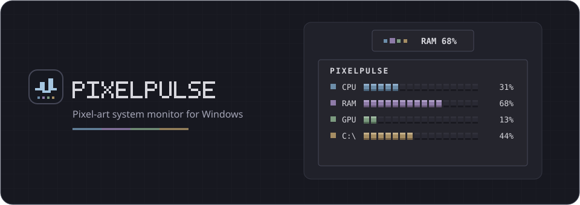

<p align="center">
  
</p>

# PixelPulse

PixelPulse is a lightweight Windows system monitor that keeps CPU, memory, graphics and storage within reach in a floating pixel-art island.

- See the busiest metric at a glance. Hover to expand, click to pin and press **ESC** to unpin.
- Right-click the island to open **System Diagnostics**. Inspect your hardware, add local drives, opt in to launch at Windows sign-in, or switch between English (US), Brazilian Portuguese and Spanish.
- Metrics stay on your PC. User preferences live in `%USERPROFILE%\.pixelpulse\settings.json`.

## Build on Windows for local testing

Use an up-to-date **Windows 11 x64** installation with WebView2, Node.js 24 LTS, stable Rust with the MSVC toolchain, and the Visual Studio C++ build tools. [Tauri prerequisites](https://v2.tauri.app/start/prerequisites/#windows)

1. From the repository root, install the pinned frontend dependencies.

   ```powershell
   npm ci
   ```

2. Build the standalone release executable.

   ```powershell
   npm run tauri build -- --no-bundle
   ```

3. Run the executable for local testing.

   ```powershell
   .\src-tauri\target\release\pixelpulse.exe
   ```

## Project documentation

[Design](docs/DESIGN.md) · [Repository map](docs/ESTRUTURA.md) · [Roadmap](docs/PLANO.md) · [Release checklist](docs/RELEASING.md)

## Licenses

PixelPulse is licensed under [GPL-3.0](LICENSE). The bundled Silkscreen font is licensed under the [SIL Open Font License 1.1](src/assets/fonts/OFL.txt).
